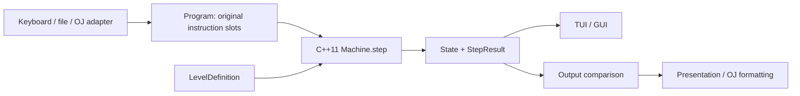

# Parsing and execution kernel design

Status: core, built-in levels, OJ adapter, and single-file export implemented.
The numeric-range and malformed-envelope policies below remain project choices
pending the detailed OJ specification.

## Development commands

- `just fmt` formats the C++ sources, headers, and tests.
- `just test` compiles the core and both OJ forms as strict C++11, checks public
  headers independently, and runs semantic and packaging regressions.
- `just pack-oj` generates `build/oj/main.cpp`; pass an output path as its first
  argument to choose another destination.
- Compile a submission with `c++ -std=c++11 build/oj/main.cpp -o build/oj/hrm-oj`.
- `xmake build hrm-oj` builds the linked OJ adapter. For a build without frontend
  dependencies, configure with `xmake f --tui=n --gui=n` first.

Packaging and test scripts require Python 3.10+ and only its standard library.
The Nix development shell supplies Python. The generated submission requires
only a C++11 compiler and standard library, with no project files or packages.

The dedicated adapter lives at `src/oj/main.cpp`. `tools/pack-oj.py` recursively
expands its shared public headers and the sorted `src/core/*.cpp` sources,
removes duplicate project headers, and retains standard includes. Output is
deterministic; source code and the interpreter are never duplicated manually.

Malformed input envelopes return exit status 1, write `Invalid OJ input` to
stderr, and write nothing to stdout. Valid envelopes always produce one of the
three specified result lines. Arithmetic uses checked signed 64-bit values.

Source: `.vscode/problem.pdf`, especially pages 2-5. The assignment takes
precedence over the commercial Human Resource Machine game. The kernel and its
public headers use C++11; FTXUI and raylib adapters may use C++20.

## Scope and dependency boundary

The kernel owns program representation, instruction decoding, machine state,
single-step execution, built-in level data, and final output comparison. It uses
only the C++11 standard library. It does not read files, print messages, render,
sleep, handle keyboard input, or persist player progress.



Use one execution implementation for every frontend and OJ. Frontends choose
when to call `step()` and how to display the returned information.

## Requirements that constrain the architecture

-   Instruction IDs and jump operands are 1-based; floor addresses are 0-based.
-   An instruction keeps its original ID across jumps and repeated execution.
-   Unknown opcodes, unavailable opcodes, bad operand counts, invalid integers,
    invalid addresses, and missing values are errors only when reached.
-   Falling past the last instruction or executing `inbox` with no remaining input
    ends execution normally. Exhausting input alone does not end execution.
-   Final output must equal the target sequence in length, order, and values.
    Matching the target before termination does not constitute success.
-   OJ emits exactly `Success`, `Fail`, or `Error on instruction X`, followed by a
    newline. No trace, counters, or UI dependencies enter that adapter.

## Data model

| Type                 | Responsibility                                                                                                              |
| -------------------- | --------------------------------------------------------------------------------------------------------------------------- |
| `Value`              | Proposed `std::int64_t` numeric value; range policy discussed below.                                                        |
| `Cell`               | `bool occupied` plus `Value value`; zero is a valid occupied value.                                                         |
| `Opcode`             | `enum class` containing the eight specified instructions.                                                                   |
| `SourceInstruction`  | Original text and optional physical source line. Instruction ID is its vector index plus one.                               |
| `Program`            | Immutable vector of source instructions, preserving all declared slots.                                                     |
| `DecodedInstruction` | Opcode and signed integer operand, when required.                                                                           |
| `DecodeResult`       | Tagged success or structured decode diagnostic; C++11 struct and enum, no `std::variant` or `std::expected`.                |
| `LevelDefinition`    | ID, description, input vector, target vector, floor size, allowed-opcode set.                                               |
| `MachineState`       | Next program counter, input cursor, hand, floor cells, output vector, counters, execution status, and terminal information. |
| `StepResult`         | Attempted instruction ID, previous and next program counters, step outcome, and diagnostic if any.                          |

The program counter is internal and 0-based. `pc == program.size()` is the
normal end sentinel, never a legal explicit jump target. A jump operand must be
in `[1, program.size()]` before conversion to an internal index.

Input remains an immutable vector plus a cursor: consuming input is O(1), and
the frontend can display remaining input without destructive queue operations.
Output grows as a vector. Every floor cell and the hand begin empty.

The machine owns its program and level data, copying or moving them at
construction. UI editing cannot invalidate an active run. A new program starts
a new run; `reset()` restarts the existing program and level.

## Loading and decoding

Separate transport errors from robot instruction errors.

1. An input adapter reads the count `M` and then exactly `M` instruction lines.
   OJ additionally reads the level ID first. The UI can construct the same
   `Program` directly from an editor.
2. The adapter preserves every slot, including empty instruction lines. It must
   not remove blank lines, renumber instructions, or tokenize across lines.
3. `decode_line()` recognizes syntax, but does not decide whether the whole
   program is runnable. The machine decodes a slot on its first visit and caches
   either its decoded instruction or its decode error for the current run.
4. A cached error is returned only when that slot is reached. Editor diagnostics
   may inspect every line, but cannot prevent execution of an otherwise runnable
   path.
5. Allowed-opcode checks and state-dependent checks happen on the reached
   instruction. No global rejection pass checks all jump targets or addresses.

Proposed grammar: exact lowercase opcode; whitespace-separated tokens; no
comments or labels. `inbox` and `outbox` require zero operands, the others exactly
one. Operands use optional `+`/`-` followed by decimal digits, with complete token
consumption and checked conversion. Reject `1x`, `1.0`, extra operands, and
out-of-range integers. Leading/trailing whitespace and CRLF line endings are
accepted. Signed values are retained until address validation so negative
addresses never wrap into unsigned indices.

An invalid level ID, invalid count, unreadable file, or premature EOF is an
adapter/load error, not automatically `Error on instruction X`. The PDF does
not specify OJ output for malformed envelopes; the detailed OJ statement must
define that mapping. Do not invent an instruction ID for an envelope error.

Proposed empty-program behavior: `M == 0` halts normally and compares empty
output with the target. The PDF does not explicitly define this case.

## Single-step semantics

Suggested public interface, using the types described above:

```cpp
class Machine {
public:
    Machine(LevelDefinition level, Program program);
    StepResult step();
    const MachineState& state() const;
    const LevelDefinition& level() const;
    const Program& program() const;
    void reset();
};
```

`MachineState` is exposed read-only. No frontend receives mutable access to the
program counter, hand, floor, or input cursor. The machine is single-threaded;
frontends own any scheduling or synchronization.

For each active `step()`:

1. Fetch the instruction at `pc`, retaining `pc + 1` as its public ID.
2. Decode it; check availability, operand shape, and all runtime preconditions.
3. On error, enter `Faulted` and record a structured error at that ID. Hand,
   floor, input cursor, output, and `pc` remain unchanged.
4. On an empty `inbox`, enter `Halted` with reason `InboxEmpty`. Preserve hand,
   floor, output, input cursor, and `pc`.
5. Otherwise perform the instruction atomically, increment the executed counter,
   and assign the next `pc`. If that equals program size, enter `Halted` with
   reason `ProgramEnd` in the same call.
6. On normal termination, compare the complete output with the target and store
   `Success` or `Fail`. On fault, store `Error` instead.

Calling `step()` after termination returns `AlreadyStopped` without changing
state or counters. An empty program starts halted with reason `ProgramEnd`.

| Instruction    | Preconditions                                 | Successful effect                                                                                     |
| -------------- | --------------------------------------------- | ----------------------------------------------------------------------------------------------------- |
| `inbox`        | None                                          | If input remains, replace hand with its next value and advance input cursor. Otherwise halt normally. |
| `outbox`       | Hand occupied                                 | Append hand value to output, then empty hand.                                                         |
| `copyto X`     | Hand occupied; floor index exists             | Copy hand into floor X, overwriting its old value; retain hand.                                       |
| `copyfrom X`   | Floor index exists and is occupied            | Replace hand with a copy; retain floor value.                                                         |
| `add X`        | Hand occupied; floor X exists and is occupied | Replace hand with hand plus floor X; retain floor value.                                              |
| `sub X`        | Hand occupied; floor X exists and is occupied | Replace hand with hand minus floor X; retain floor value.                                             |
| `jump X`       | Target instruction exists                     | Set `pc` to X minus one.                                                                              |
| `jumpifzero X` | Target exists; hand occupied                  | Jump if hand is zero, otherwise advance normally.                                                     |

For `jumpifzero`, validate the target even when the hand is nonzero: the table
on page 4 lists a nonexistent target as an error without a taken-branch
qualification. Jumping to an existing but malformed instruction is legal;
the error belongs to that target instruction when it is subsequently executed.

Expose both attempted and completed instruction counts. A fault or empty-inbox
halt increments attempted count but not completed count; a successful final
instruction increments both. These are explicit project conventions because
the PDF requests statistics without specifying these counting edge cases.

Expected instruction work is O(1) after decoding, with amortized O(1) output
append. No full-state snapshot is copied automatically on each step. A frontend
can copy the read-only state when it needs a persistent animation/history frame;
OJ stores no execution history.

## Errors, termination, and host control

Keep three concepts separate:

-   Execution status: `Running`, `Halted`, or `Faulted`.
-   Normal halt reason: `ProgramEnd` or `InboxEmpty`.
-   Verdict: `Pending`, `Success`, `Fail`, or `Error`.

Diagnostics include a stable error code and original instruction ID. Proposed
codes: `UnknownOpcode`, `OpcodeNotAllowed`, `WrongOperandCount`,
`InvalidInteger`, `OperandOutOfRange`, `InvalidFloorIndex`, `EmptyFloorCell`,
`EmptyHand`, and `InvalidJumpTarget`. The presentation layer supplies explanatory
text; the OJ formatter uses only the instruction ID.

When several preconditions fail, validation follows this fixed order: syntax
(opcode, operand count, integer token), level permission, floor/jump bounds,
hand presence, floor-cell occupancy, and arithmetic overflow. Interactive
diagnostics are deterministic. OJ does not expose the detailed reason. Never
emit both an error and a success/failure verdict.

Do not stop early on a wrong output prefix or a complete matching output: a
later instruction may still produce a required error. Compare at normal halt.

A valid program can run forever (`jump 1` in levels 2/3). UI runners execute a
bounded number of steps per frame and yield with the machine still `Running`.
Pause, cancellation, and a UI watchdog are host controls, not robot faults or
`Fail`. No arbitrary instruction limit is introduced into OJ semantics.

The PDF specifies neither numeric bounds nor overflow behavior. Proposed
initial policy: signed 64-bit values and checked addition/subtraction, with
`ArithmeticOverflow` as a project extension if a result cannot be represented.
This requires confirmation against the detailed OJ statement before finalizing
the numeric model; it is not a rule established by the PDF. Never rely on signed
overflow or claim 64-bit values represent every mathematical integer.

## Levels and application services

Built-in levels are immutable data supplied to the machine:

| Level | Input                       | Target                        | Floor slots | Available instructions |
| ----- | --------------------------- | ----------------------------- | ----------- | ---------------------- |
| 1     | `1, 2`                      | `1, 2`                        | 0           | `inbox`, `outbox`      |
| 2     | `3, 9, 5, 1, -2, -2, 9, -9` | `-6, 6, 4, -4, 0, 0, 18, -18` | 3           | All eight              |
| 3     | `6, 2, 7, 7, -9, 3, -3, -3` | `7, -3`                       | 3           | All eight              |

The fourth creative level is a later content decision. A custom-level loader
can eventually construct the same `LevelDefinition`; file format and storage
are outside the execution kernel. Level descriptions are presentation data and
do not implement the judgment rule.

Level unlocking and saved completion records belong to an application service
above the machine. Only a terminal `Success` authorizes marking a level passed.
The OJ adapter selects levels 1-3 directly without player-profile dependencies.

## Proposed implementation layout and OJ export

```text
include/hrm/
  core.hpp              public umbrella header
  types.hpp             values, cells, enums, diagnostics
  program.hpp           source program and decoder contracts
  level.hpp             level data and built-in level lookup
  machine.hpp           state, step result, machine API
src/core/
  program.cpp           instruction decoder
  level.cpp             built-in levels
  machine.cpp           execution and final comparison
src/oj/main.cpp         input envelope and exact one-line output
tests/core/             semantic and parser regression tests
tools/                  deterministic single-file OJ export tool
```

The source layout above is implemented; regression tests are `tests/core.cpp`
and `tests/run-tests.py` rather than a nested `tests/core/` directory.
Current flat `src/core/*.cpp` and `include/hrm/*.hpp` xmake patterns can cover
this layout. All public headers must compile independently as C++11.

The dependency-free `hrm-oj` C++11 target and deterministic export tool combine
the same core headers, implementations,
and OJ entry point in dependency order, strip project-local includes, and keep
standard-library includes. Compile the exported file with `-std=c++11` and run
the same OJ fixtures against both forms. Do not maintain a second interpreter.

## Verification plan

1. Decoder: all eight opcodes; whitespace/CRLF; signed integers; empty lines;
   unknown opcode; extra/missing operands; partial integer tokens; range errors.
2. State transitions: hand replacement/clearing; zero vs empty cells; floor
   overwrite; subtraction direction; jumps; valid addresses at both boundaries.
3. Deferred validation: malformed/unavailable/out-of-range instructions skipped
   by a jump or by normal termination never cause an error. For level 2,
   `jump 3 / invalid / inbox` ends normally with `Fail`, not an error at 2.
4. Reachability: with nonzero hand, `jumpifzero 99` still faults if 99 does not
   exist; jumping to a malformed existing instruction faults at the target ID.
5. Termination: an empty `inbox` is a normal halt; empty input without an inbox
   attempt is not. Falling off the end also compares output. Repeated terminal
   `step()` calls change nothing.
6. Judgment: exact, missing, extra, wrong-order and wrong-value outputs; a
   correct output followed by a fault must yield an error. For level 1,
   `inbox / outbox / inbox / outbox / outbox` errors at instruction 5.
7. Original IDs: revisiting an instruction does not renumber errors; blank
   instruction slots retain their IDs. State stays unchanged on a fault.
8. Built-in tasks: valid solutions for all three fixed levels and representative
   failing programs. Verify reset yields the same deterministic trace.
9. Host scheduling: a looping program yields after a step budget without a
   terminal verdict. Running in different slice sizes yields identical states
   after equal attempted instruction counts.
10. Integration: all public headers and core sources compile as C++11, frontend
    targets as C++20, and exported OJ code matches the linked adapter byte for
    byte on output, with no UI dependencies or trace output.

Suggested implementation order: data types and decoder, built-in level data,
single-step machine and regression tests, OJ adapter/export, then frontend
controllers and persistence. Resolve the OJ numeric and envelope ambiguities
before treating those policies as final.
